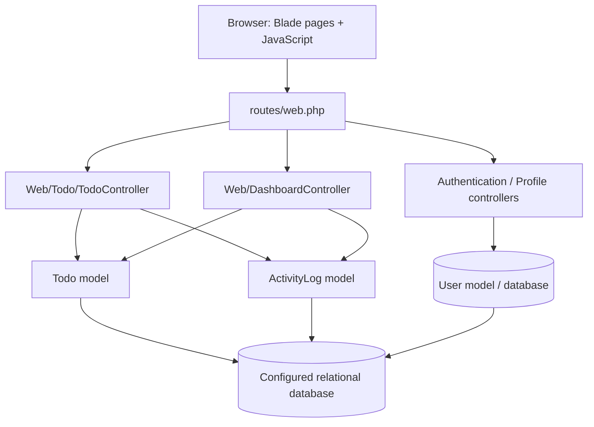

# Architecture

> Scope: source-based overview of the current Tymetry-web Laravel application. This document describes the code inspected on 2026-10-20; it is not a guarantee that every flow has been tested.

## Overview

Tymetry-web is a server-rendered Laravel application for managing personal todos. Blade renders the main pages, JavaScript enhances the todo table with DataTables/AJAX interactions, and Eloquent models persist users, todos, and activity logs.

## High-level request flow

## Main code areas

| Area | Responsibility |
|---|---|
| `routes/web.php` | Declares login, password reset, OTP, dashboard, todo, and profile routes. Dashboard/todo/profile routes are grouped behind the `auth` middleware. |
| `app/Http/Controllers/Web/Auth/` | Authentication-related request handling, including login, OTP, and password recovery. |
| `app/Http/Controllers/Web/Todo/TodoController.php` | Todo listing/filtering, CRUD, status/priority/due-date changes, archive/restore, and bulk operations. |
| `app/Http/Controllers/Web/DashboardController.php` | Calculates dashboard counts, due-date lists, recent tasks, and recent activity. |
| `app/Http/Controllers/Web/ProfileController.php` | Profile and password updates. |
| `app/Http/Requests/TodoRequest.php` | Shared validation for creating/updating todos. |
| `app/Models/User.php` | User authentication model; exposes todo and activity-log relationships. |
| `app/Models/Todo.php` | Todo persistence, enum casts, due-date labels/states, smart ordering, and soft deletes. |
| `app/Models/ActivityLog.php` | Stores user-linked activity entries for todo actions. |
| `app/Enums/Todo/TodoStatus.php` | Defines Pending, Progress, and Done states. |
| `app/Enums/Todo/TodoPriority.php` | Defines Low, Medium, and High priorities. |
| `resources/views/` | Blade templates for authentication, dashboard, todo list/forms/archive, and profile screens. |
| `database/migrations/` | Defines the persistent schema. Confirm exact schema details from the current migrations before changing data structures. |

## Todo lifecycle

1. An authenticated user opens the todo list.
2. The controller scopes the query to the current user's ID, applies filters and smart ordering, and returns either the Blade page or DataTables JSON for AJAX requests.
3. Create/edit requests are validated by `TodoRequest` and persisted through the authenticated user's todo relationship.
4. Inline actions update status, priority, or due date through dedicated endpoints.
5. Archiving uses Eloquent soft deletes; the archive view queries trashed todos, and restore brings a todo back.
6. Selected todos can be marked done, archived, or restored in bulk.
7. The dashboard queries the current user's todos and activity logs to build summaries and due-date lists.

## Data relationships

- A `User` has many `Todo` records.
- A `User` has many `ActivityLog` records.
- A `Todo` has many `ActivityLog` records.
- Todos use soft deletes so archived records can be restored rather than permanently removed.

## Important implementation notes

- Status and priority are integer-backed PHP enums and are cast by the `Todo` model.
- The `smartOrder()` query scope prioritizes unfinished overdue/today tasks ahead of later tasks, then orders by priority and due date. Verify the desired ordering with tests if the rule changes.
- Most todo reads and mutations should be scoped to the authenticated user. Preserve this ownership boundary when adding endpoints.
- Some controller handlers currently validate status/priority less strictly than `TodoRequest` validates normal form submissions. Tighten endpoint validation and cover invalid payloads with tests.
- The inspected standard status-update handler sets `completed_at`, while quick-complete and bulk-done paths do not consistently maintain it. Decide the intended timestamp behavior and test it before changing the implementation.
- The architecture diagram is intentionally high-level. It does not imply a separate API service, queue, or frontend SPA; the current todo app is a Laravel web application.

## Change guidance

For a typical feature, update the relevant controller/request/model/view and migration only as needed. Add or update focused tests, run the test suite, then update this document if the architecture or data flow materially changes.
