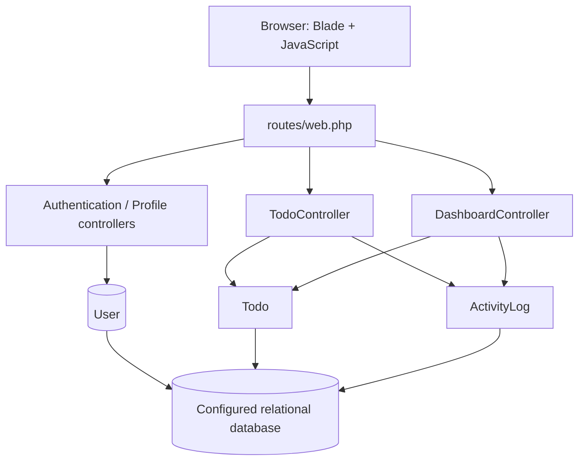

# Architecture

> Scope: source-based overview of the current Tymetry-web Laravel application. Updated 2026-11-27. This document describes the inspected implementation; it is not a claim that every production integration has been exercised.

## Overview

Tymetry-web is a server-rendered Laravel todo manager. Blade renders pages, JavaScript enhances the todo table with DataTables/AJAX, and Eloquent persists users, todos, and activity logs.

## Request flow

## Main code areas

| Area | Responsibility |
|---|---|
| `routes/web.php` | Login, password reset, OTP, dashboard, todo, and profile routes. Login and OTP/password-reset endpoints have route-level throttles. |
| `app/Http/Controllers/Web/Auth/` | Login, OTP, and password-recovery request handling. |
| `app/Services/Auth/OtpService.php` | OTP generation, hashed challenge storage, expiry/attempt handling, and email delivery. |
| `app/Http/Controllers/Web/Todo/TodoController.php` | Todo listing/filtering, CRUD, inline actions, archive/restore, and bulk endpoints. |
| `app/Http/Controllers/Web/DashboardController.php` | User-scoped counts, due-date lists, and recent activity. |
| `app/Http/Controllers/Web/ProfileController.php` | Profile, password, and two-factor preference updates. |
| `app/Http/Requests/TodoRequest.php` | Create/edit validation, including supported status and priority enum values. |
| `app/Models/User.php` | Authentication model and todo/activity-log relationships. |
| `app/Models/Todo.php` | Enum casts, completion timestamp invariant, due-date labels/states, smart ordering, and soft deletes. |
| `app/Models/ActivityLog.php` | User-linked activity entries for todo actions. |
| `app/Enums/Todo/` | Integer-backed todo status and priority values/labels. |
| `resources/views/` | Blade templates for authentication, dashboard, todos, archive, profile, and shared layouts. |
| `database/migrations/` | Persistent schema, including todos and activity logs. |

## Board and TYMX behavior

- Board is an alternative presentation of the same user-scoped Todo records; it does not create a separate task entity or lifecycle.
- Board status movement reuses the authenticated Todo status mutation path so validation, ownership, completion metadata, and activity logging remain server-authoritative.
- TYMX v1 export serializes the supported Todo fields using stable public IDs rather than internal integer database IDs.
- TYMX M6 import is validation and preview only. It identifies matching records and field-level differences but does not write Todo or ActivityLog data. Import Apply (M7) is not implemented.

## Todo lifecycle and invariants

1. Authenticated todo queries are scoped to the current user.
2. Create/edit requests use `TodoRequest`; status and priority values are constrained to their supported enums.
3. The `Todo` saving hook sets `completed_at` when status is Done and clears it otherwise. This applies to model saves/updates, including bulk actions that iterate through models.
4. Dedicated endpoints handle status, priority, and due-date changes. The table renders the matching controls, and the JavaScript uses the registered HTTP methods.
5. Archive uses Eloquent soft deletes; restore returns archived records to the active list.
6. Bulk endpoints validate a non-empty array of distinct integer IDs and scope mutations to the authenticated user.
7. Dashboard due-date lists exclude completed tasks and are scoped to the signed-in user.

## Product decisions and UI behavior

- `due_time` is persisted and editable, but remains **metadata only**. It does not change task ordering, dashboard grouping, or reminder behavior.
- The responsive workspace switches to a horizontal navigation strip at narrow widths; the navigation strip can scroll horizontally. Todo and archive tables use responsive wrappers.
- Success feedback is presented through the shared application toast. Page-level duplicate success alerts were removed.
- Todo form labels are associated with their controls; Status/Priority validation errors are displayed inline. Archive selection checkboxes have accessible names.

## Authentication and concurrency notes

- Email OTP challenges use cache-backed coordination; deployed behavior depends on a shared cache store and the configured mail transport.
- TOTP MFA secrets are encrypted and excluded from normal User serialization; recovery codes are stored as hashes within the encrypted recovery-code attribute.
- Account-level TOTP attempt checking and verification are serialized by a per-account cache lock (PR #55). Lock contention fails closed.
- Automated SQLite tests do not prove multi-process behavior with the intended production MySQL/cache combination. See Issues #40 and #41 and the safe-environment verification checklist in TESTING.md.

## Verification notes

Focused regression tests cover enum validation, completion consistency, bulk ownership/validation, due-time persistence, profile email uniqueness, smart ordering on the configured test database, authentication verification, dashboard due-date behavior, table presentation, and shell navigation.

The OTP controller and service are implemented. Automated tests mock the OTP service for authentication-flow behavior; actual email delivery still depends on the deployed mail transport and should be smoke-tested in the target environment.

Responsive CSS and markup were inspected. Browser verification at specific viewport sizes remains a manual check; see [TESTING.md](TESTING.md).

## Change guidance

For a typical feature, update the relevant controller/request/model/view and migration only as needed. Add focused regression tests, run the suite, and update this document only when architecture, data flow, or product behavior materially changes.
