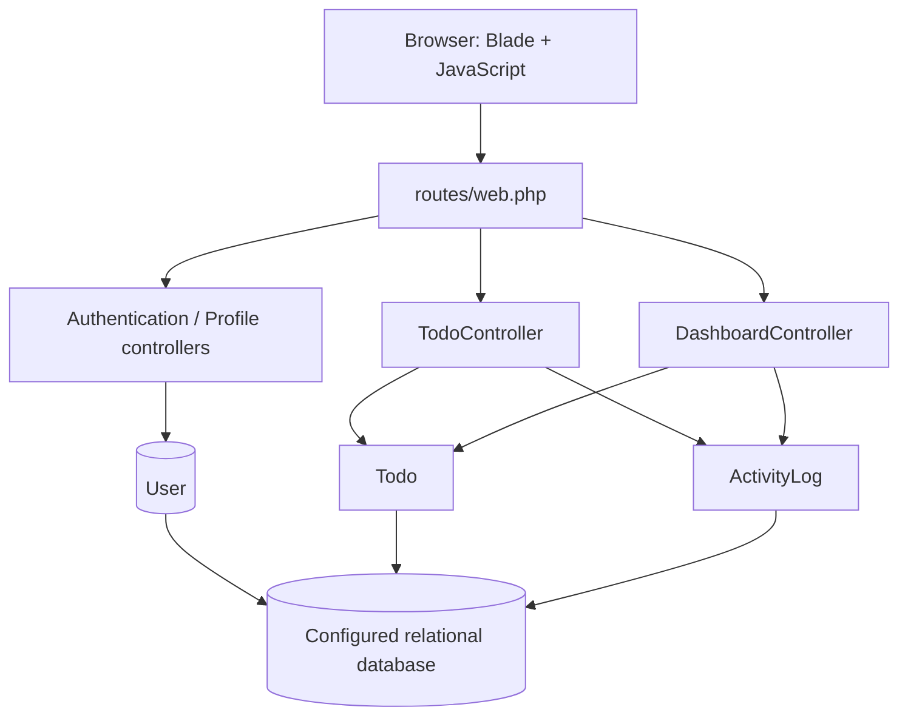

# Architecture

> Scope: source-based overview of the current Tymetry-web Laravel application. Reviewed on 2026-10-20; this describes the inspected code, not proof that every flow works.

## Overview

Tymetry-web is a server-rendered Laravel todo manager. Blade renders pages, JavaScript enhances the todo table with DataTables/AJAX, and Eloquent persists users, todos, and activity logs.

## Request flow

## Main code areas

| Area | Responsibility |
|---|---|
| `routes/web.php` | Login, password reset, OTP, dashboard, todo, and profile routes. Dashboard/todo/profile routes use `auth` middleware. |
| `app/Http/Controllers/Web/Auth/` | Login, OTP, and password-recovery request handling. |
| `app/Http/Controllers/Web/Todo/TodoController.php` | Todo listing/filtering, CRUD, inline actions, archive/restore, and bulk endpoints. |
| `app/Http/Controllers/Web/DashboardController.php` | Dashboard counts, due-date lists, recent tasks, and activity. |
| `app/Http/Controllers/Web/ProfileController.php` | Profile and password updates. |
| `app/Http/Requests/TodoRequest.php` | Validation for create/edit requests. |
| `app/Models/User.php` | Authentication model and todo/activity-log relationships. |
| `app/Models/Todo.php` | Enum casts, due-date labels/states, smart ordering, and soft deletes. |
| `app/Models/ActivityLog.php` | User-linked activity entries for todo actions. |
| `app/Enums/Todo/` | Integer-backed todo status and priority values/labels. |
| `resources/views/` | Blade templates for authentication, dashboard, todos, archive, and profile. |
| `database/migrations/` | Persistent schema, including todos and activity logs. |

## Todo lifecycle

1. An authenticated user opens the todo list.
2. The controller scopes todo queries to the current user, applies filters/order, and returns the page or DataTables JSON.
3. Create/edit requests are validated and persisted through the authenticated user's todo relationship.
4. Dedicated endpoints handle status, priority, and due-date changes.
5. Archive uses Eloquent soft deletes; restore returns archived records to the active list.
6. Bulk endpoints mark todos done, archive them, or restore archived records.
7. The dashboard queries the current user's todos and activity logs.

## Relationships and invariants

- A user has many todos and activity logs.
- A todo has many activity logs.
- Todos use soft deletes so archived records can be restored.
- Status and priority are integer-backed PHP enums cast by the `Todo` model.
- Most todo reads and mutations must remain scoped to the authenticated user's ID. Preserve this ownership boundary when adding endpoints.
- `smartOrder()` uses `CURDATE()` and currently assumes a MySQL-compatible database; PHPUnit is configured for SQLite, so this is a test-compatibility concern.
- The todo table's JavaScript and routes must agree on HTTP methods. The priority and due-date routes are `PATCH`, but their current JavaScript handlers send `POST`; the corresponding controls also are not currently included in the rendered DataTables columns.
- OTP endpoints are present in routing but their controller actions are currently empty, so OTP should be treated as unfinished rather than working authentication functionality.

## Current review notes

The source skim found gaps around enum-value validation, consistent `completed_at` handling, missing inline controls and HTTP-method mismatches, incomplete `due_time` persistence, profile email uniqueness, login throttling, SQLite compatibility, and unfinished OTP handlers. The full list of findings lives in [REVIEW-FINDINGS.md](REVIEW-FINDINGS.md), and the recommended regression checks live in [TESTING.md](TESTING.md).

## Change guidance

For a typical feature, update the relevant controller/request/model/view and migration only as needed. Add focused regression tests, run the suite, and update this document only when architecture or data flow materially changes.
